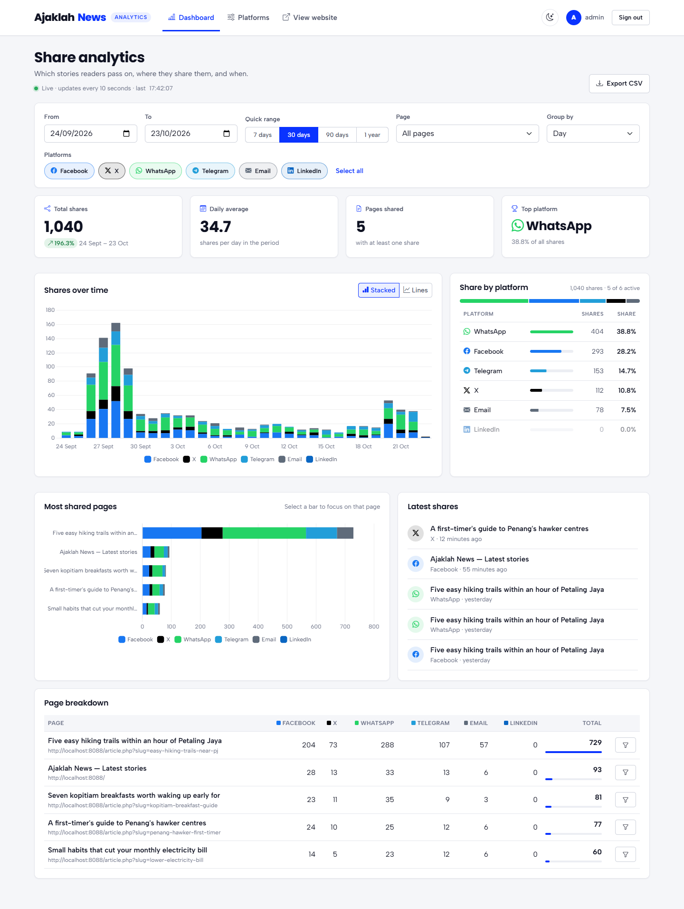

# Social Share Tracker

A small news website with share buttons (Facebook, X, WhatsApp, Telegram, Email).
Every click is counted, and an admin dashboard shows the numbers as charts.

Built with **PHP + MySQL**, **Bootstrap 5** and **Chart.js**.



---

## Contents

1. [What you need](#1-what-you-need)
2. [Install the tools (if you don't have them)](#2-install-the-tools-if-you-dont-have-them)
3. [Get the project](#3-get-the-project)
4. [Set up the database](#4-set-up-the-database)
5. [Start the site](#5-start-the-site)
6. [Try it out](#6-try-it-out)
7. [Run the tests](#7-run-the-tests)
8. [Problems?](#8-problems)

---

## 1. What you need

| Tool | Version | Check it with |
|---|---|---|
| PHP | 8.1 or newer | `php -v` |
| MySQL or MariaDB | MySQL 5.7+ or MariaDB 10.3+ | it must be running |
| Git | any | `git --version` |

You also need internet in the browser, because Bootstrap and Chart.js load from a CDN.

If all three checks work, skip to [step 3](#3-get-the-project).

---

## 2. Install the tools (if you don't have them)

Pick your computer below.

### Windows

The easiest way is **XAMPP**, which gives you PHP and MySQL in one installer.

1. Download and install XAMPP from https://www.apachefriends.org (pick a version with PHP 8.1 or newer).
2. Open the **XAMPP Control Panel** and click **Start** next to **MySQL**.
3. Download and install Git from https://git-scm.com/download/win (keep the default options).

XAMPP does not add PHP to your command line. So in the steps below, use the full path instead of `php`:

```powershell
C:\xampp\php\php.exe -v
```

> Tip: to type just `php`, add `C:\xampp\php` to your Windows **PATH** (search "Edit the system environment variables" → Environment Variables → Path → New), then open a new terminal.

XAMPP's MySQL user is `root` with **no password**, which is what the setup command below uses.

### macOS

Install [Homebrew](https://brew.sh) first if you don't have it, then run:

```bash
brew install php mysql git
brew services start mysql
```

Homebrew's MySQL user is `root` with **no password**.

### Linux (Ubuntu / Debian)

```bash
sudo apt update
sudo apt install -y php-cli php-mysql php-mbstring mysql-server git
sudo systemctl start mysql
```

On Ubuntu, the MySQL `root` user can't log in with a password from PHP. So create a user for this project:

```bash
sudo mysql -e "CREATE USER 'tracker'@'localhost' IDENTIFIED BY 'tracker123'; GRANT ALL PRIVILEGES ON social_share_tracker.* TO 'tracker'@'localhost';"
```

Then in step 4, use `--db-host=localhost --db-user=tracker --db-pass=tracker123`.

---

## 3. Get the project

Open a terminal (on Windows: **PowerShell** or **Git Bash**) and run:

```bash
git clone https://github.com/dannyozzy-03/social-share-tracker.git
cd social-share-tracker
```

All the commands below are run from inside this `social-share-tracker` folder.

---

## 4. Set up the database

Make sure MySQL is running, then run:

```bash
php bin/install.php --db-user=root --db-pass= --admin-pass=Admin@12345 --demo
```

On Windows with XAMPP, without PATH set:

```powershell
C:\xampp\php\php.exe bin/install.php --db-user=root --db-pass= --admin-pass=Admin@12345 --demo
```

This one command:

- creates the settings file `config/config.php`
- creates the database `social_share_tracker` and its tables
- creates the admin login (`admin` / `Admin@12345`)
- adds 90 days of demo share clicks so the charts have data

If your MySQL user has a password, put it after `--db-pass=`, for example `--db-pass=mypassword`.

You should see lines starting with `[ok]`. If you see an error, check [Problems?](#8-problems).

---

## 5. Start the site

```bash
php -S localhost:8000 -t public
```

(XAMPP without PATH: `C:\xampp\php\php.exe -S localhost:8000 -t public`)

Keep this terminal open while you use the site. Press `Ctrl + C` to stop it.

---

## 6. Try it out

| Page | Link | Login |
|---|---|---|
| Website | http://localhost:8000 | none |
| Admin dashboard | http://localhost:8000/admin/ | `admin` / `Admin@12345` |

1. Open the website and click any share button on an article.
2. The share window opens, and the counter next to the buttons goes up.
3. Open the admin dashboard. The new click appears within 10 seconds, with no page reload.
4. Use the filters (date, platform, page) or export the data to CSV.

---

## 7. Run the tests

```bash
php tests/run.php
```

---

## 8. Problems?

| Problem | Fix |
|---|---|
| `php` is not recognized | PHP isn't installed or isn't on your PATH. See [step 2](#2-install-the-tools-if-you-dont-have-them). On XAMPP, use `C:\xampp\php\php.exe`. |
| `Could not connect to MySQL` | MySQL isn't running, or the user/password is wrong. Start MySQL (XAMPP Control Panel, `brew services start mysql` or `sudo systemctl start mysql`) and check `--db-user` / `--db-pass`. |
| I fixed my password but the setup still uses the old one | The first run already saved `config/config.php`. Delete that file and run step 4 again. |
| `could not find driver` | PHP's MySQL extension is missing. Linux: `sudo apt install php-mysql`. XAMPP has it already. |
| Port 8000 is already in use | Choose any available port, for example `php -S localhost:8080 -t public`, then open `http://localhost:8080`. No config change is needed. |
| Page loads with no styling or charts | The browser needs internet to load Bootstrap and Chart.js. |
| Want to start over with clean data | `php bin/install.php --fresh --admin-pass=Admin@12345 --demo` (this deletes all data and rebuilds it) |
| Forgot the admin password | `php bin/create-admin.php admin "NewPassword123"` |

---

## More detail

See [docs/DETAILS.md](docs/DETAILS.md) for how tracking works, the API, the database tables, security notes and how to run it on XAMPP Apache or with phpMyAdmin.
