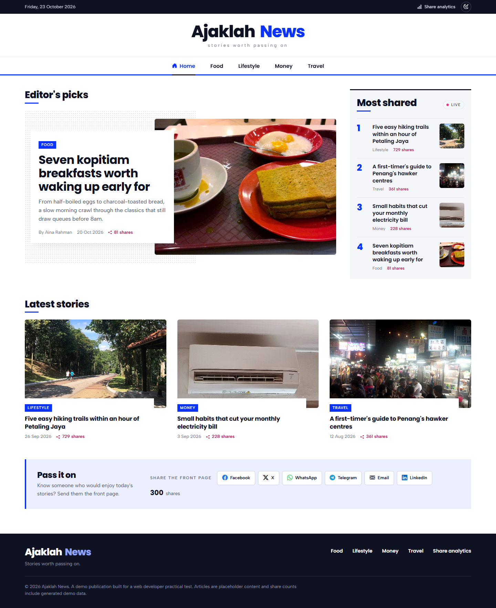
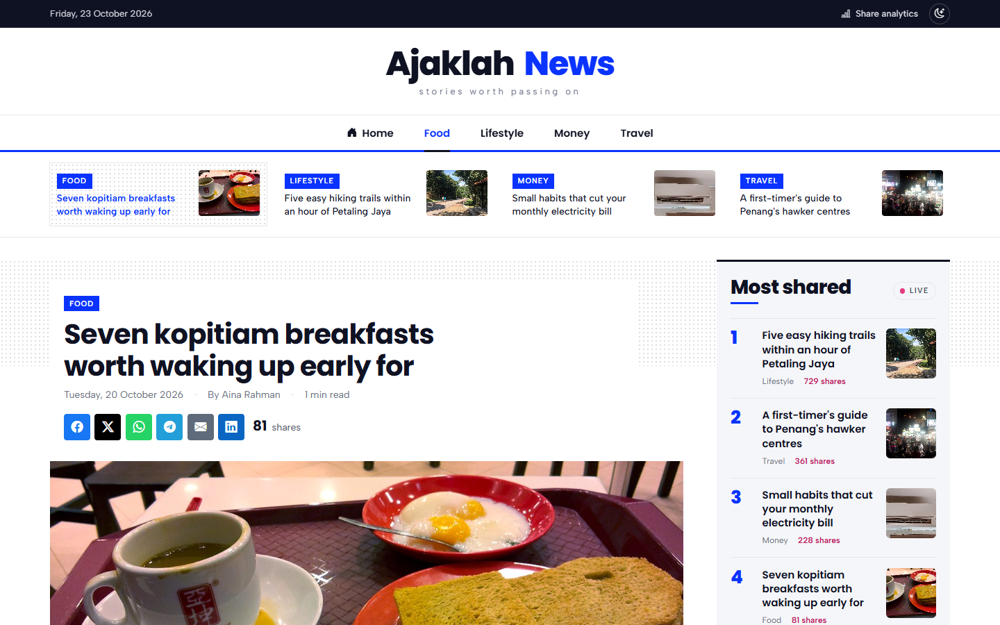
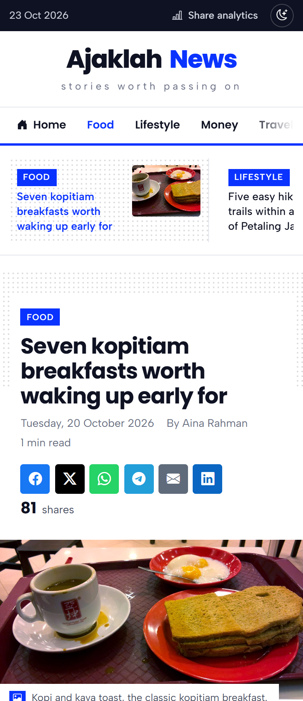
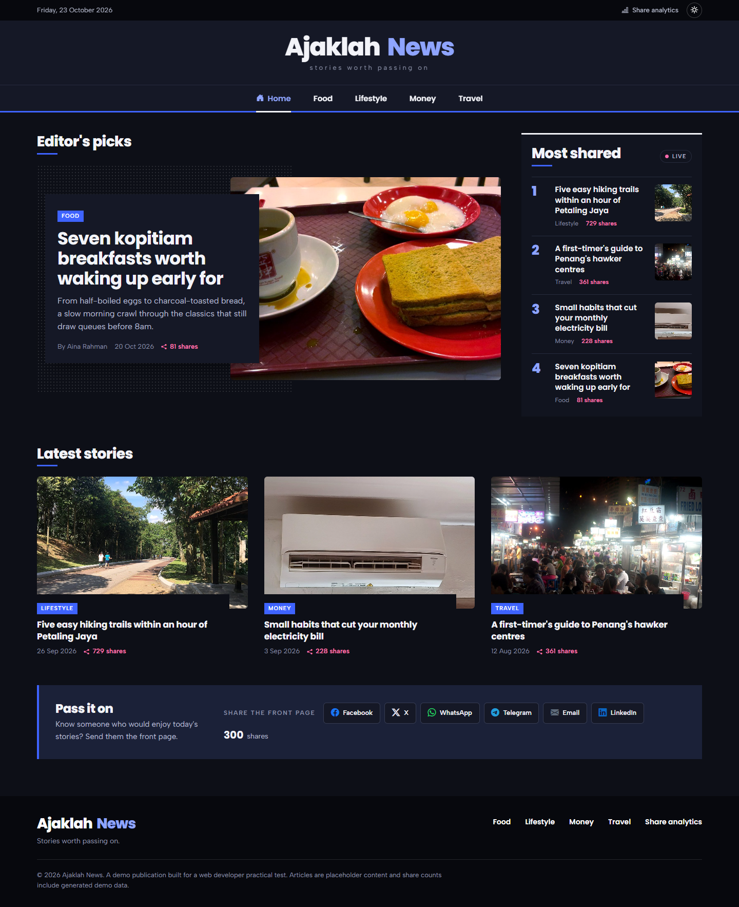

# Social Share Tracker

A small news website (**Ajaklah News**) with share buttons that count every click, plus an admin dashboard that shows those clicks as live charts.

Built with plain **PHP 8 + MySQL**: no framework and no Composer. The UI uses **Bootstrap 5** and the charts use **Chart.js 4**.




| Article page | Mobile | Dark mode |
|---|---|---|
|  |  |  |

---

## What it does

- **Share buttons** for Facebook, X, WhatsApp, Telegram and Email on every page. Each button shares the page's URL, title and description.
- **Click tracking.** Every click is sent to the server and saved in the database.
- **Live counts.** Share counts on the website and the dashboard update by themselves every 10 seconds, with no page reload.
- **Admin dashboard** (login required) with charts of shares by platform, over time and by page, a feed of the latest shares and a per-page table.
- **Filters** by date range, platform, page and day/week/month. Filters apply instantly and are saved in the URL. Results can be exported to CSV.
- **Add new platforms** (e.g. Reddit) from the admin. They appear everywhere without code changes.
- **Light and dark mode** on every page. Light is the default; the moon/sun button in the header switches it, and the browser remembers the choice.

---

## Run it (2 commands)

You need **PHP 8.1+** (with `pdo_mysql` and `mbstring`) and **MySQL 5.7+ / 8** or **MariaDB 10.3+**. XAMPP has all of these.

```bash
# 1. Create the config, database, tables, admin account and 90 days of demo data
php bin/install.php --db-user=root --db-pass= --admin-pass=Admin@12345 --demo

# 2. Start the site
php -S localhost:8000 -t public
```

| Page | URL | Login |
|---|---|---|
| Website | http://localhost:8000 | none |
| Admin | http://localhost:8000/admin/ | `admin` / `Admin@12345` |

Port 8000 busy? Pick another port and pass it to the installer too: `--app-url=http://localhost:8080`, then `php -S localhost:8080 -t public`.

The browser needs internet access, because Bootstrap, Bootstrap Icons and Chart.js load from a CDN.

### On XAMPP (Apache)

1. Copy the folder to `C:\xampp\htdocs\social-share-tracker`.
2. Start **Apache** and **MySQL** in the XAMPP Control Panel.
3. From the project folder, run:
   ```bash
   C:\xampp\php\php.exe bin/install.php --app-url=http://localhost/social-share-tracker --admin-pass=Admin@12345 --demo
   ```
4. Open http://localhost/social-share-tracker.

The root `.htaccess` serves only `public/` and blocks the private folders.

### Without the installer (phpMyAdmin)

1. Create a database `social_share_tracker` (collation `utf8mb4_unicode_ci`).
2. Import `database/schema.sql`, then `database/seed.sql`, then `database/default_admin.sql`.
3. Copy `config/config.example.php` to `config/config.php` and fill in the database details and `app.url`.
4. Optional demo data: `php bin/seed-demo.php`.

To change the admin password, run `php bin/create-admin.php admin "new-password"`.

---

## How a share is tracked

1. A reader clicks a share button, e.g. **WhatsApp**.
2. The WhatsApp share window opens straight away.
3. At the same time, `share.js` sends `{ platform, url, title }` to `POST /api/track.php`.
4. The server checks the input (known platform, allowed website, sensible URL, not spamming) and saves one row in `share_clicks`.
5. The server replies with the page's new total, and the counter on the page goes up.
6. Other open pages pick up the new total within 10 seconds (`GET /api/counts.php`), and so does the dashboard (`GET /admin/api/stats.php`).

Buttons are normal links, so sharing still works with JavaScript turned off. Only the tracking needs JavaScript.

---

## API

**`POST /api/track.php`**: records a click.

```json
{ "platform": "whatsapp", "url": "http://localhost:8000/article.php?slug=easy-hiking-trails-near-pj", "title": "Five easy hiking trails…" }
```

| Status | Meaning |
|---|---|
| `201` | Saved. Body: `{"ok":true,"recorded":true,"total":787}` |
| `200` | Same click repeated within 10 seconds, so it wasn't counted again |
| `422` | Invalid input. Body lists the errors per field |
| `400` | Body is not valid JSON or is larger than 8 KB |
| `403` | Request came from another website |
| `429` | Too many clicks from one visitor (over 30 a minute) |

**`GET /api/counts.php?url[]=…&url[]=…`**: current share totals for up to 20 pages. Used for the live counts.

**`GET /admin/api/stats.php`** (admin login required): the dashboard data. Takes `from`, `to`, `granularity` (`day`, `week` or `month`), `platforms[]` and `page`. `GET /admin/export.php` takes the same filters and returns a CSV file.

---

## Database

| Table | Holds |
|---|---|
| `platforms` | One row per share button: name, share URL template, icon, colour, on/off |
| `pages` | Every page that has been shared, found by a hash of its cleaned-up URL |
| `share_clicks` | One row per click: platform, page, hashed visitor IP, time |
| `admins` | Admin accounts (bcrypt passwords) |
| `login_attempts` | Recent logins, for the brute-force lockout |

- A new platform is just a new row, because share links are templates like `https://t.me/share/url?url={url}&text={title}`.
- URLs are cleaned before saving (tracking tags like `utm_*`, `fbclid` and `#fragments` are removed), so variants count as one page.
- Platforms are hidden, never deleted, so old clicks stay in the reports.

---

## Add a new platform

Go to **Admin → Platforms → Add platform**. For example, Reddit:

| Field | Value |
|---|---|
| Name | Reddit |
| Slug | `reddit` |
| Share URL template | `https://www.reddit.com/submit?url={url}&title={title}` |
| Icon | `bi-reddit` (any [Bootstrap Icon](https://icons.getbootstrap.com/)) |
| Brand colour | `#FF4500` |

Save it. The button then shows on every page, in the filters and in every chart.

---

## Settings

Defaults are in `config/config.example.php`. Your own values go in `config/config.php`, which the installer creates and git ignores.

| Setting | Default | What it does |
|---|---|---|
| `app.url` | `http://localhost:8000` | The site's address. Only pages on this host (plus `tracking.allowed_hosts`) are tracked |
| `app.secret` | generated | Secret key used to hash visitor IPs |
| `app.timezone` | `Asia/Kuala_Lumpur` | Time zone for storing and grouping clicks |
| `db.*` | `127.0.0.1:3306`, `root`, no password | Database connection |
| `tracking.dedupe_seconds` | `10` | Ignore the same click repeated within this many seconds |
| `tracking.max_per_minute` | `30` | Click limit per visitor |
| `admin.session_idle_minutes` | `30` | Sign out after this long idle |
| `admin.max_login_attempts` / `lockout_minutes` | `5` / `15` | Lock out an IP after too many wrong passwords |

---

## Security

- **SQL injection:** every query uses PDO prepared statements.
- **XSS:** all output is escaped. The dashboard builds the page with `textContent`, never `innerHTML`. A strict Content-Security-Policy blocks inline scripts.
- **CSRF:** every admin form has a token, and the tracking API rejects requests from other websites.
- **Login:** bcrypt passwords, a new session ID on login, secure cookies, an idle timeout and a lockout after 5 wrong passwords.
- **Tracking abuse:** only known platforms and allowed websites are accepted. The API also enforces a URL length limit, an 8 KB body limit, a rate limit and 10-second de-duplication.
- **Privacy:** visitor IPs are stored only as a keyed hash, never as the raw IP.
- **CSV export:** cells are protected against spreadsheet formula injection.

---

## Tests

```bash
php tests/run.php
```

29 unit tests cover URL cleaning, validation, share links and dashboard filters. The GitHub Actions workflow (`.github/workflows/ci.yml`) runs them on PHP 8.1–8.4, installs against a real MySQL 8 database and smoke-tests the site and the API.

---

## Folders

```
bin/         command-line scripts: install, create-admin, seed-demo
config/      settings (config.example.php → your config.php)
database/    SQL scripts: schema, default platforms, default admin
public/      the web root: pages, api/, admin/, assets/ (css, js, images, fonts)
src/         PHP code: tracking, stats, repositories, security, validation
templates/   HTML templates for the site and the admin
tests/       unit tests
```

---

## Notes

- **It counts clicks, not finished posts.** Social networks don't tell a website whether the reader actually posted, so the tracker counts button clicks, as the brief asks.
- **Link previews need a public URL.** Facebook, X, WhatsApp and Telegram read the page's Open Graph tags from the internet, so previews only appear once the site is online (not on `localhost`).
- **Live updates use polling.** The site checks every 10 seconds, and only while the tab is visible. It doesn't use WebSockets, which would need a long-running server; PHP's built-in server handles one request at a time.
- **The articles are demo content** (`src/Content/ArticleRepository.php`). In production they would come from the CMS.
- **The design:** the front page follows a Malaysian news-portal layout: a section nav, an editor's pick, a live "Most shared" ranking and a story grid. The admin is a clean analytics dashboard. Share buttons carry each platform's brand colour. The fonts (Poppins and Albert Sans) are self-hosted under the SIL Open Font License.

### Photo credits

The cover photos in `public/assets/img/covers/` are cropped to 1200×630. Each file's JPEG comment repeats its credit.

| Cover | Photo | Licence |
|---|---|---|
| Front page | [The Twins SE Asia 2019](https://commons.wikimedia.org/wiki/File:The_Twins_SE_Asia_2019_(49171985716).jpg) by James Kerwin | CC BY 2.0 |
| Kopitiam breakfasts | [Typical Singapore breakfast: Kopi and kaya toast](https://www.flickr.com/photos/39952962@N00/9575232043) by decade_null | CC BY 2.0 |
| Hiking trails | [Bukit Kiara Park 3](https://commons.wikimedia.org/wiki/File:Bukit_Kiara_Park_3.jpg) by Slleong | CC0 |
| Electricity bill | [Modern split-type air conditioner at a school](https://commons.wikimedia.org/wiki/File:Modern_split-type_air_conditioner_at_a_school.jpg) by Curpharar | CC BY-SA 4.0 |
| Penang hawker centres | [The ever busy Gurney drive hawker centre](https://www.flickr.com/photos/7952984@N02/13533157564) by suran2007 | CC BY 2.0 |
