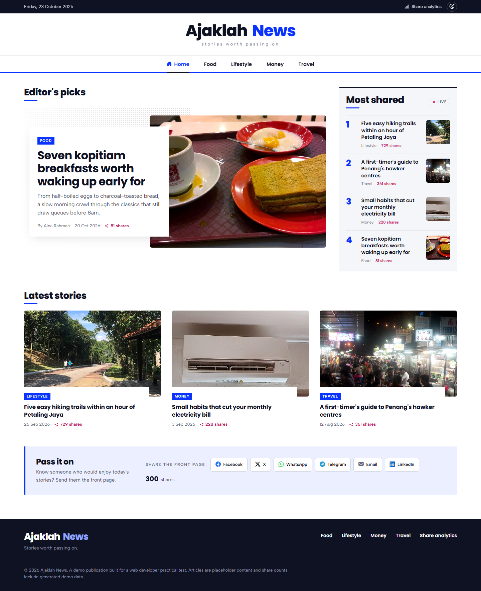
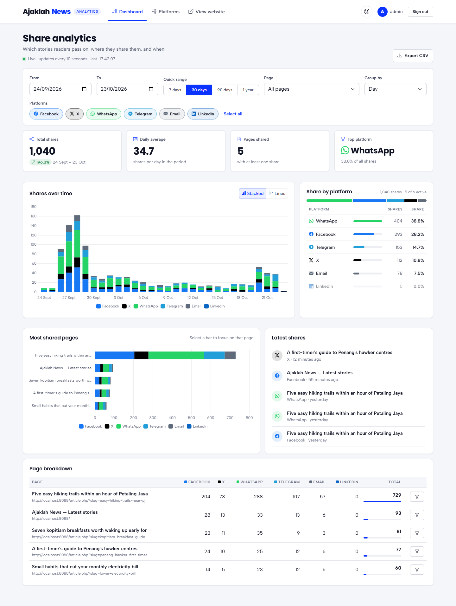
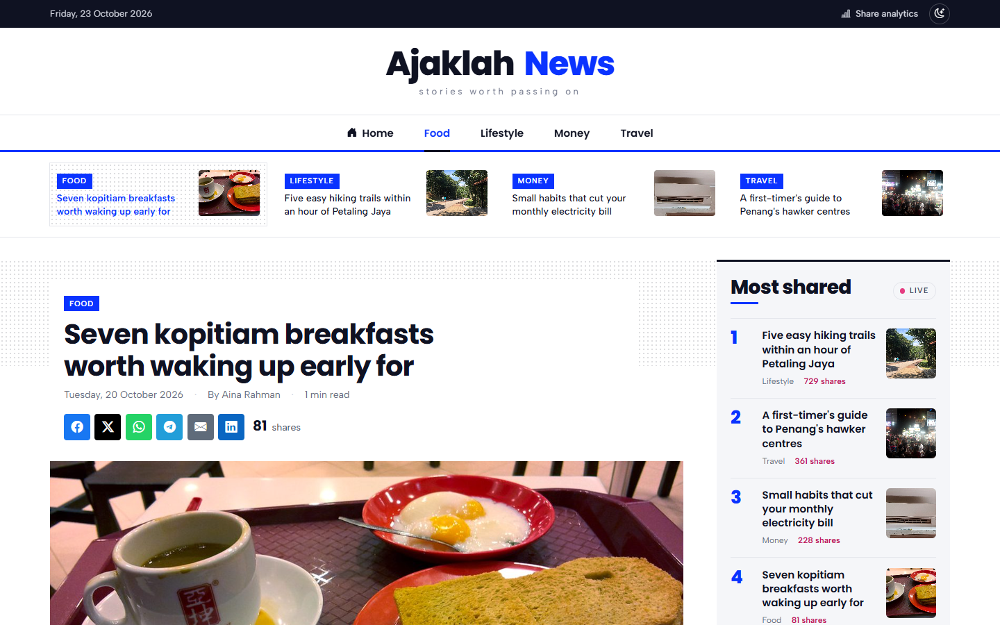
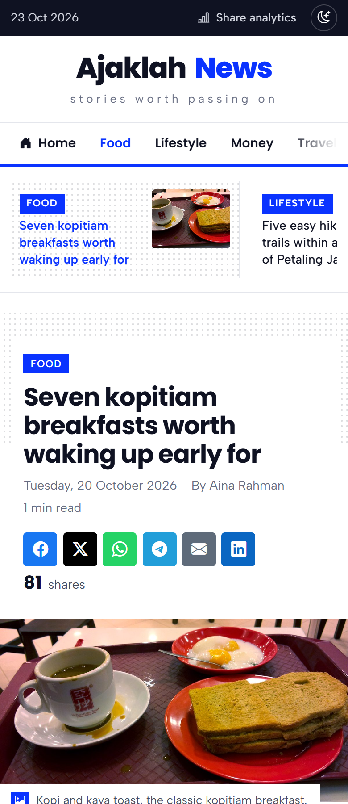
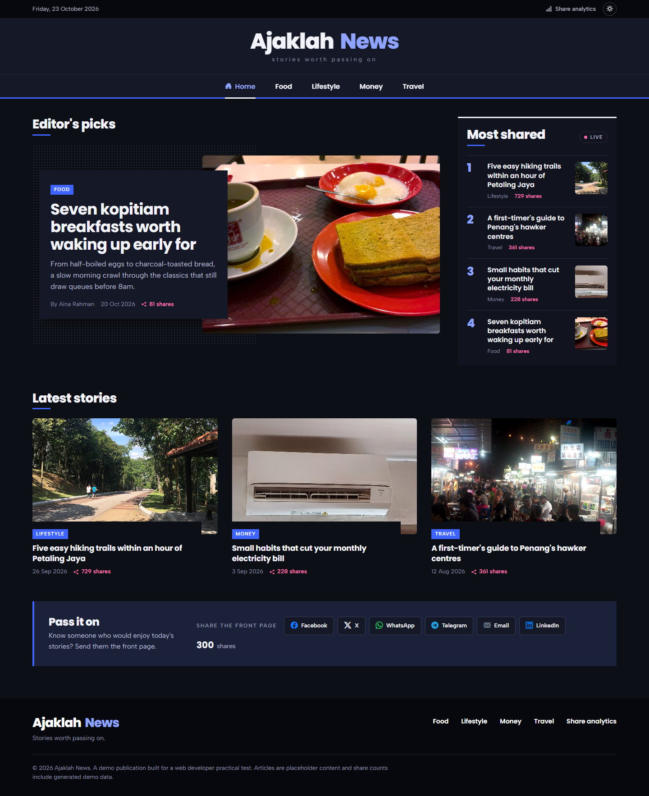
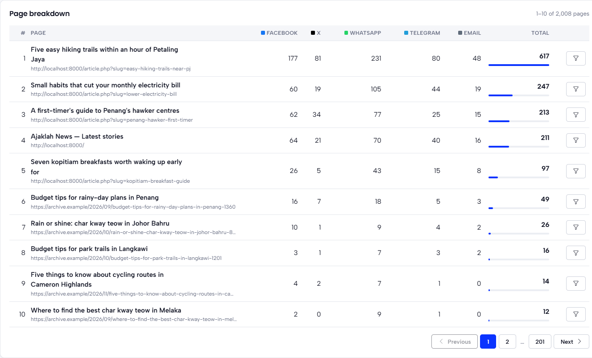
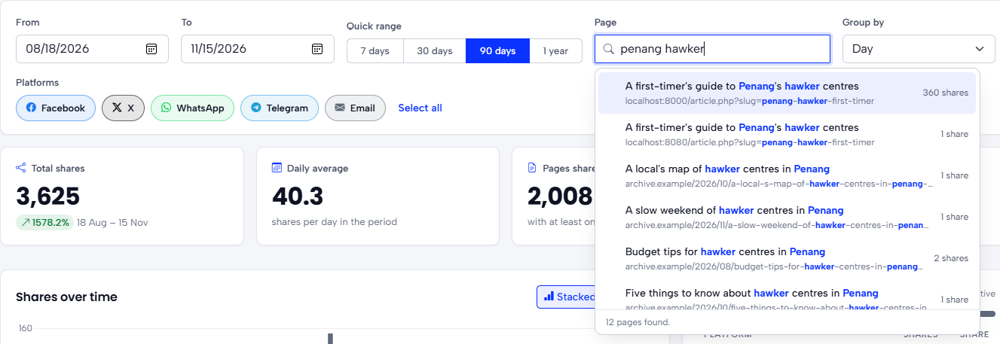

# Social Share Tracker

A small news website (**Ajaklah News**) with share buttons that count every click, plus an admin dashboard that shows those clicks as live charts.

Built with plain **PHP 8 + MySQL**: no framework and no Composer. The UI uses **Bootstrap 5** and the charts use **Chart.js 4**.





| Article page | Mobile | Dark mode |
|---|---|---|
|  |  |  |

---

## What it does

- **Share buttons** for Facebook, X, WhatsApp, Telegram and Email on every page. Each button shares the page's URL, title and description.
- **Click tracking.** Every click is sent to the server and saved in the database.
- **Live counts.** Share counts on the website and the dashboard update by themselves every 10 seconds, with no page reload.
- **Admin dashboard** (login required) with charts of shares by platform, over time and by page, a feed of the latest shares and a per-page table.
- **Built for a big archive.** The front page shows the newest story plus 6 more per page, with numbered pages (`?page=2`, also on section pages). **Trending (Most Shared)** is a top-5 chart (top 6 on article and section pages), and the story strip under the menu shows the 10 newest stories. On the dashboard, the page filter is a search box and the **Page breakdown** table is paged, 10 rows at a time.
- **Filters** by date range, platform, page and day/week/month. Filters apply instantly and are saved in the URL. Results can be exported to CSV.
- **Add new platforms** (e.g. Reddit) from the admin. They appear everywhere without code changes.
- **Light and dark mode** on every page. Light is the default; the moon/sun button in the header switches it, and the browser remembers the choice.

---

## Run it (2 commands)

You need **PHP 8.1+** (with `pdo_mysql` and `mbstring`) and **MySQL 5.7+ / 8** or **MariaDB 10.3+**. XAMPP has all of these.

```bash
# 1. Create the config, database, tables, admin account and 90 days of demo data
php bin/install.php --db-user=root --db-pass= --admin-pass=Admin@12345 --demo

# 2. Start the site
php -S localhost:8000 -t public
```

| Page | URL | Login |
|---|---|---|
| Website | http://localhost:8000 | none |
| Admin | http://localhost:8000/admin/ | `admin` / `Admin@12345` |

Port 8000 busy? Pick any available port, for example `php -S localhost:8080 -t public`, and open `http://localhost:8080`. Localhost links automatically use the port serving the current request; no installer or config change is needed.

The browser needs internet access, because Bootstrap, Bootstrap Icons and Chart.js load from a CDN.

### On XAMPP (Apache)

1. Copy the folder to `C:\xampp\htdocs\social-share-tracker`.
2. Start **Apache** and **MySQL** in the XAMPP Control Panel.
3. From the project folder, run:
   ```bash
   C:\xampp\php\php.exe bin/install.php --app-url=http://localhost/social-share-tracker --admin-pass=Admin@12345 --demo
   ```
4. Open http://localhost/social-share-tracker.

The root `.htaccess` serves only `public/` and blocks the private folders.

### Without the installer (phpMyAdmin)

1. Create a database `social_share_tracker` (collation `utf8mb4_unicode_ci`).
2. Import `database/schema.sql`, then `database/seed.sql`, then `database/default_admin.sql`.
3. Copy `config/config.example.php` to `config/config.php` and fill in the database details and `app.url`.
4. Optional demo data: `php bin/seed-demo.php`.

To change the admin password, run `php bin/create-admin.php admin "new-password"`.

### Try it with a big archive

The demo site has 12 stories. To see how the dashboard copes with a large site, add a few thousand extra shared pages:

```bash
php bin/seed-demo.php --archive=2000    # add 2,000 extra pages with realistic share counts
php bin/seed-demo.php --remove-archive  # take them out again
```

The extra pages live under `https://archive.example/` (a reserved example domain), so your own data is never touched, and running `--archive` again replaces them instead of adding more. A few are shared a lot and most only once or twice, spread over the last 90 days: pick **90 days** on the dashboard to see them all.

**Page breakdown** lists every shared page, ranked, 10 rows at a time. The `#` column is the overall rank, the bars are scaled to the period's top page so they compare across pages, and the 10-second live refresh keeps you on the page you are reading:



**The page filter** is a search box instead of a drop-down, so the dashboard no longer sends every page to the browser. Type any words from a title or address; matches load 20 at a time, with more as you scroll:



It copes with a much bigger site too. With 50,000 shared pages (`--archive=50000`), the dashboard's HTML stays the same size (about 20 KB), a page search answers in about 0.1 s and the full 90-day report in about 0.2 s (measured on a laptop with PHP's built-in server). The ranking behind **Most shared pages** and **Page breakdown** counts shares per page ID first and only then looks up the 10 pages on screen, which keeps the 10-second live refresh cheap.

---

## How a share is tracked

1. A reader clicks a share button, e.g. **WhatsApp**.
2. The WhatsApp share window opens straight away.
3. At the same time, `share.js` sends `{ platform, url, title }` to `POST /api/track.php`.
4. The server checks the input (known platform, allowed website, sensible URL, not spamming) and saves one row in `share_clicks`.
5. The server replies with the page's new total, and the counter on the page goes up.
6. Other open pages pick up the new total within 10 seconds (`GET /api/counts.php`), and so does the dashboard (`GET /admin/api/stats.php`).

Buttons are normal links, so sharing still works with JavaScript turned off. Only the tracking needs JavaScript.

---

## API

**`POST /api/track.php`**: records a click.

```json
{ "platform": "whatsapp", "url": "http://localhost:8000/article.php?slug=easy-hiking-trails-near-pj", "title": "Five easy hiking trails…" }
```

| Status | Meaning |
|---|---|
| `201` | Saved. Body: `{"ok":true,"recorded":true,"total":787}` |
| `200` | Same click repeated within 10 seconds, so it wasn't counted again |
| `422` | Invalid input. Body lists the errors per field |
| `400` | Body is not valid JSON or is larger than 8 KB |
| `403` | Request came from another website |
| `429` | Too many clicks from one visitor (over 30 a minute) |

**`GET /api/counts.php?url[]=…&url[]=…`**: current share totals for up to 20 pages. Used for the live counts.

**`GET /admin/api/stats.php`** (admin login required): the dashboard data. Takes `from`, `to`, `granularity` (`day`, `week` or `month`), `platforms[]` and `page`, plus `breakdown_page` for the **Page breakdown** table, which lists every shared page ranked by shares, 10 at a time (a page past the end returns the last one). `GET /admin/export.php` takes the same filters and returns a CSV file.

**`GET /admin/api/pages.php?q=…&limit=20&offset=0`** (admin login required): searches shared pages for the dashboard's **Page** filter. Every word in `q` must appear in the page title or URL (`%` and `_` match literally). With no `q`, the newest pages come first. Returns at most `limit` (1–50) pages with their all-time share totals, plus `has_more` and `next_offset` for the next batch. The page filter is a search box rather than a drop-down, so the dashboard stays fast however many articles the site has: it loads 20 matches at a time and more as you scroll.

---

## Database

| Table | Holds |
|---|---|
| `platforms` | One row per share button: name, share URL template, icon, colour, on/off |
| `pages` | Every page that has been shared, found by a hash of its cleaned-up URL |
| `share_clicks` | One row per click: platform, page, hashed visitor IP, time |
| `admins` | Admin accounts (bcrypt passwords) |
| `login_attempts` | Recent logins, for the brute-force lockout (rows older than 7 days are pruned) |

- A new platform is just a new row, because share links are templates like `https://t.me/share/url?url={url}&text={title}`.
- URLs are cleaned before saving (tracking tags like `utm_*`, `fbclid` and `#fragments` are removed), so variants count as one page.
- Platforms are hidden, never deleted, so old clicks stay in the reports.

---

## Add a new platform

Go to **Admin → Platforms → Add platform**. For example, Reddit:

| Field | Value |
|---|---|
| Name | Reddit |
| Slug | `reddit` |
| Share URL template | `https://www.reddit.com/submit?url={url}&title={title}` |
| Icon | `bi-reddit` (any [Bootstrap Icon](https://icons.getbootstrap.com/)) |
| Brand colour | `#FF4500` |

Save it. The button then shows on every page, in the filters and in every chart.

---

## Settings

Defaults are in `config/config.example.php`. Your own values go in `config/config.php`, which the installer creates and git ignores.

| Setting | Default | What it does |
|---|---|---|
| `app.url` | `http://localhost:8000` | The site's address. Only pages on this host (plus `tracking.allowed_hosts`) are tracked |
| `app.secret` | generated | Secret key used to hash visitor IPs |
| `app.timezone` | `Asia/Kuala_Lumpur` | Time zone for storing and grouping clicks |
| `db.*` | `127.0.0.1:3306`, `root`, no password | Database connection |
| `tracking.dedupe_seconds` | `10` | Ignore the same click repeated within this many seconds |
| `tracking.max_per_minute` | `30` | Click limit per visitor |
| `admin.session_idle_minutes` | `30` | Sign out after this long idle |
| `admin.max_login_attempts` / `lockout_minutes` | `5` / `15` | Lock out an IP after too many wrong passwords |

---

## Security

- **SQL injection:** every query uses PDO prepared statements.
- **XSS:** all output is escaped. The dashboard builds the page with `textContent`, never `innerHTML`. A strict Content-Security-Policy blocks inline scripts.
- **CSRF:** every admin form has a token, and the tracking API rejects requests from other websites.
- **Login:** bcrypt passwords, a new session ID on login, secure cookies, an idle timeout and a lockout after 5 wrong passwords. An unknown username takes as long to reject as a wrong password, so response times don't reveal which usernames exist. If the session ID cannot be renewed, sign-in is refused rather than continuing on the old ID.
- **Tracking abuse:** only known platforms and allowed websites are accepted. The API also enforces a URL length limit, an 8 KB body limit, a rate limit and 10-second de-duplication.
- **Privacy:** visitor IPs are stored only as a keyed hash, never as the raw IP.
- **CSV export:** cells are protected against spreadsheet formula injection. If the database fails mid-download, the file ends with an "EXPORT INCOMPLETE" line instead of being silently short.
- **Third-party files:** Bootstrap, Bootstrap Icons and Chart.js load with Subresource Integrity hashes, so a tampered CDN file is refused.
- **Headers:** HSTS on HTTPS, a Permissions-Policy, `nosniff`, `SAMEORIGIN` framing and a strict Referrer-Policy.
- **Sessions:** the website's sign-in indicator never creates a session for ordinary visitors, and the CSRF token is replaced at sign-in.

---

## Error handling

One rule is applied across `src/`:

- **Every exception the app throws extends `App\Exception\AppException`**: `DatabaseException`, `ConfigurationException`, `ValidationException` and `RateLimitException`.
- **Classes that touch I/O catch the low-level error and rethrow a typed one.** Every public repository method (and `ShareStats`, `LoginThrottle`, `DemoSeeder`, `SqlFile`, `Database`) wraps its queries in `try`/`catch (PDOException)` and throws a `DatabaseException` that names the operation ("Database error while trying to load the platforms") and keeps the driver error as `getPrevious()`. SQL and credentials never appear in the message. `Auth`, `Csrf`, `Config` and `View` do the same for sessions, random tokens, config files and templates.
- **Pure classes have nothing to catch**: `Validator`, `Url`, `ShareLinkBuilder`, `StatsFilter`, `Paginator`, `PageSearch`, `PlatformForm`, `ShareTracker` and `ArticleRepository` do no I/O of their own. They only throw `ValidationException` (or `RateLimitException`) for bad input, and let a repository's `DatabaseException` pass through untouched.
- **Every class says which kind it is.** Each of the 27 classes in `src/` has an `Error handling:` line in its header comment. It says what the class catches and what it throws instead, or why it has nothing to catch, or (for an exception) who throws it and who answers it. So the rule can be checked file by file, without reading this page.
- **The rule is enforced by a test**, `tests/ErrorHandlingConventionTest.php`. It fails if any class runs SQL without catching `PDOException`, or if any public method of a database class lets a raw driver error escape (it calls every one of them against a connection that always fails). It also fails if a class without `try`/`catch` is not on the pure list or does I/O, if an exception class does not extend `AppException`, or if a class's `Error handling:` line is missing or doesn't match its code (a class without `try`/`catch` must say it has nothing to catch, and a class with one must say what it catches).
- **Entry points catch what they can answer**: `422` for validation, `429` for rate limits, a field error for a duplicate platform slug. Everything else reaches the handler in `src/bootstrap.php`, which logs it and answers `503` + `Retry-After` when the database is down, or `500` otherwise, as HTML or JSON. Details are shown only when `app.debug` is on.
- **Demo data is written in one transaction**, so a failed seed rolls back instead of leaving half-deleted data.

---

## Tests

```bash
php tests/run.php
```

The tests cover pagination, URL cleaning, validation, share links, dashboard filters, sign-in, the page search, the Page breakdown ranking and the demo archive (run against an in-memory SQLite database), and the error-handling rule for every class (using a database connection that always fails). The GitHub Actions workflow (`.github/workflows/ci.yml`) runs them on PHP 8.1–8.4. It also installs against a real MySQL 8 database, loads a 500-page archive, and smoke-tests the site, the front-page pages, the share API and the admin's page search and Page breakdown APIs. It also checks that the dashboard's HTML lists none of those pages.

---

## Folders

```
bin/         command-line scripts: install, create-admin, seed-demo
config/      settings (config.example.php → your config.php)
database/    SQL scripts: schema, default platforms, default admin
public/      the web root: pages, api/, admin/, assets/ (css, js, images, fonts)
src/         PHP code: tracking, stats, repositories, security, validation
templates/   HTML templates for the site and the admin
tests/       unit tests
```

---

## Notes

- **It counts clicks, not finished posts.** Social networks don't tell a website whether the reader actually posted, so the tracker counts button clicks, as the brief asks.
- **Link previews need a public URL.** Facebook, X, WhatsApp and Telegram read the page's Open Graph tags from the internet, so previews only appear once the site is online (not on `localhost`).
- **Live updates use polling.** The site checks every 10 seconds, and only while the tab is visible. It doesn't use WebSockets, which would need a long-running server; PHP's built-in server handles one request at a time.
- **The articles are demo content** (`src/Content/ArticleRepository.php`). In production they would come from the CMS.
- **The design:** the front page follows a Malaysian news-portal layout: a section nav, an editor's pick, a live "Trending (Most Shared)" ranking of all stories and a story grid. The admin is a clean analytics dashboard. Share buttons carry each platform's brand colour. The fonts (Poppins and Albert Sans) are self-hosted under the SIL Open Font License.

### Photo credits

The cover photos in `public/assets/img/covers/` are cropped to 1200×630. Each file's JPEG comment repeats its credit.

| Cover | Photo | Licence |
|---|---|---|
| Front page | [The Twins SE Asia 2019](https://commons.wikimedia.org/wiki/File:The_Twins_SE_Asia_2019_(49171985716).jpg) by James Kerwin | CC BY 2.0 |
| Kopitiam breakfasts | [Typical Singapore breakfast: Kopi and kaya toast](https://www.flickr.com/photos/39952962@N00/9575232043) by decade_null | CC BY 2.0 |
| Hiking trails | [Bukit Kiara Park 3](https://commons.wikimedia.org/wiki/File:Bukit_Kiara_Park_3.jpg) by Slleong | CC0 |
| Electricity bill | [Modern split-type air conditioner at a school](https://commons.wikimedia.org/wiki/File:Modern_split-type_air_conditioner_at_a_school.jpg) by Curpharar | CC BY-SA 4.0 |
| Penang hawker centres | [The ever busy Gurney drive hawker centre](https://www.flickr.com/photos/7952984@N02/13533157564) by suran2007 | CC BY 2.0 |
